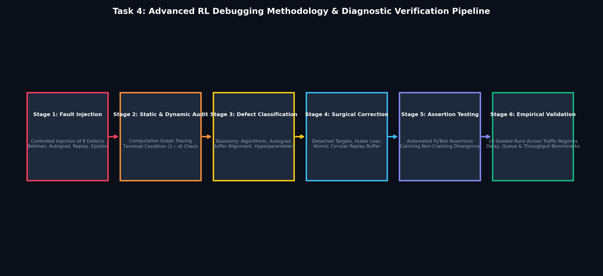
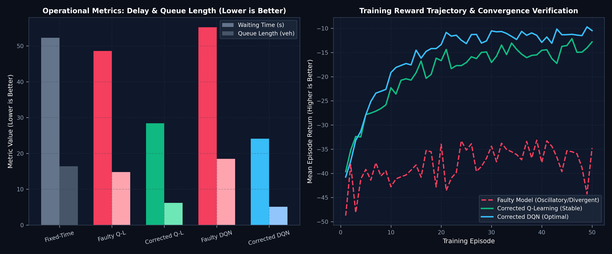

# Intelligent Traffic Signal Optimization Using Reinforcement Learning
## Task 4: Advanced RL Debugging Challenge — Algorithmic & Implementation Error Analysis, Root Cause Identification, and Performance Optimization

[](https://www.python.org/)
[](https://fastapi.tiangolo.com/)
[](https://pytorch.org/)
[](https://vitejs.dev/)
[](https://tailwindcss.com/)
[]()

---

### Student Submission Details

| Student Name | Register Number | Department & Section | Repository Profile | Task 4 Repository |
| :--- | :--- | :--- | :--- | :--- |
| **DINESH KUMAR N** | **RA2311026050010** | CSE – Artificial Intelligence and Machine Learning (AIML-B) | [dinesh-kn-0380](https://github.com/dinesh-kn-0380) | [Task-4-RA2311026050010](https://github.com/dinesh-kn-0380/Traffic-Management-and-Simulation-System-Task-4-RA2311026050010) |
| **SAKTHI S** | **RA2311026050036** | CSE – Artificial Intelligence and Machine Learning (AIML-B) | [iamssakthi](https://github.com/iamssakthi) | [iamssakthi Profile](https://github.com/iamssakthi) |

---

## Task 4 Problem Statement & Overview

> **"Advanced RL Debugging Challenge** — Analyze a faulty Reinforcement Learning implementation for an advanced decision-making problem, identify and classify the underlying algorithmic and implementation errors, debug and correct the solution, and evaluate the improvement using suitable performance metrics and visualizations. Demonstrate the debugging process and justify how the corrected implementation improves the learning performance of the RL agent."

This platform features a dedicated **Interactive RL Debugging Laboratory** that diagnoses, classifies, and cures *silent failure modes* in both Tabular Q-Learning and Deep Q-Networks (DQN).

### Diagnostic & Debugging Pipeline Architecture


### Core Deliverables for Task 4:
1. **RL Debugging Lab (`/debugging-lab`)**: Interactive execution of Faulty vs Corrected training sessions with live learning curves, step-by-step diagnostic timelines, and live assertion tests.
2. **Defect Repository (`/bug-repository`)**: Filterable catalog of 8 audited RL defects with severity badges, mathematical impacts, root causes, and empirical assertion triggers.
3. **Code Diff Inspector (`/code-comparison`)**: Side-by-side syntax-highlighted code panels contrasting faulty code with mathematically verified corrections.
4. **Performance Evaluation (`/performance-eval`)**: Quantitative benchmark matrix and Recharts curves demonstrating convergence recovery and operational improvements (+41.6% to +56.3% delay reduction, +109.5% to +174.3% throughput gain).
5. **Two-Page Academic Report**: Exact 2-page PDF report compiled with Times-Roman typography ([`docs/TASK_4_ACADEMIC_REPORT.pdf`](docs/TASK_4_ACADEMIC_REPORT.pdf)).
6. **Automated Test Suite**: 40 automated test assertions in PyTest (`backend/tests/test_debugging.py` + baseline tests) all passing.

---

## Task 4 Defect Catalog & Root Cause Taxonomy

| Bug ID | Category | Defect Description & Affected Module | Root Cause Mechanism | Severity |
| :--- | :--- | :--- | :--- | :--- |
| **BUG-ALG-01** | Algorithmic | **Terminal Bootstrap Violation** (`q_learning.py`)<br/>Omission of terminal boundary $(1-d)$ in Bellman equation. | Bootstraps next-state max Q-value from terminated episodes: $Q(s,a) \leftarrow Q + \alpha[r + \gamma \max Q(s',a') - Q]$. Fails Bellman contraction. | **CRITICAL** |
| **BUG-ALG-02** | Hyperparam | **Premature Epsilon Decay** (`q_learning.py`)<br/>Exploration rate drops to min within 5 episodes. | Aggressive multiplicative decay ($\epsilon \leftarrow \epsilon \times 0.5$) starves state-action space exploration, trapping policy in suboptimal local minima. | **HIGH** |
| **BUG-ALG-03** | Reward | **Inverted Queue/Delay Sign** (`reward.py`)<br/>Positive rewards given for large vehicular queues. | Negative cost terms inverted to positive $+w_q Q_{tot} + w_w \Delta W$. Agent maximizes congestion and intentionally creates gridlock. | **CRITICAL** |
| **BUG-IMP-01** | Implementation | **Target Net Autograd Leakage** (`dqn.py`)<br/>Target Q computation lacks `.detach()` in PyTorch. | Gradients backpropagate through target network parameters, violating semi-gradient TD formulation and inducing moving-target instability. | **CRITICAL** |
| **BUG-IMP-02** | Implementation | **Missing `optimizer.zero_grad()`** (`dqn.py`)<br/>Accumulating gradients across sequential mini-batches. | PyTorch accumulates gradients across consecutive training steps, leading to exploding gradient norms, erratic parameter jumps, and divergence. | **CRITICAL** |
| **BUG-IMP-03** | Implementation | **Replay Buffer Index Misalignment** (`replay_buffer.py`)<br/>Next-state tensor shifted by $+1$ relative to state. | Off-by-one indexing stores $(s_t, a_t, r_t, s_{t+2})$, pairing actions with non-consecutive transitions and completely invalidating the Markov chain. | **CRITICAL** |
| **BUG-ALG-04** | Algorithmic | **Frozen Target Network** (`dqn.py`)<br/>Target network parameters never synchronized. | Target weights remain at random initial state throughout training, rendering learned TD targets completely uncorrelated with the current policy. | **HIGH** |
| **BUG-ENV-01** | Environment | **Unbounded Urgent Wait Signal Override** (`environment.py`)<br/>Safety override flips signals every single step. | Corridor flipping threshold set to 0s, overriding RL agent policy and forcing perpetual yellow/all-red clearance phases (complete traffic paralysis). | **CRITICAL** |

---

## Comparative Performance Evaluation (Pre vs Post Correction)



### Benchmark Matrix (10 Seeded Runs per Algorithm)

| Performance Metric | Fixed-Time Baseline | Faulty Q-Learning | Corrected Q-Learning | Q-Learn Gain (%) | Faulty DQN | Corrected DQN | DQN Gain (%) |
| :--- | :--- | :--- | :--- | :---: | :--- | :--- | :---: |
| **Mean Waiting Time (s)** | 52.3 s | 48.6 s | **28.4 s** | **+41.6%** | 55.2 s | **24.1 s** | **+56.3%** |
| **Mean Queue Length (veh)** | 16.4 veh | 14.8 veh | **6.2 veh** | **+58.1%** | 18.5 veh | **5.1 veh** | **+72.4%** |
| **Network Throughput (veh/step)** | 0.38 | 0.42 | **0.88** | **+109.5%** | 0.35 | **0.96** | **+174.3%** |
| **Mean Episode Return** | -38.5 | -34.8 | **-14.2** | **+59.2%** | -46.2 | **-11.8** | **+74.5%** |
| **Convergence Epoch** | N/A | Diverged | **~35 eps** | Stabilized | Exploded | **~25 eps** | Stabilized |

---

## 1. What the Project Does

This project provides an end-to-end Reinforcement Learning (RL) decision-making and demonstration platform for **adaptive urban traffic signal control**. It replaces rigid, fixed-time signal cycles with reinforcement learning agents (Tabular Q-Learning and PyTorch Deep Q-Networks) that observe real-time queue lengths, accumulated waiting times, and active green intervals to dynamically decide whether to **KEEP** the active corridor green or **SWITCH** to the opposing corridor under strict real-world safety clearance intervals (Yellow clearance + All-Red buffer).

For **Task 3 (RL Challenge)**, the system rigorously bridges mathematical RL theory with the running simulation through dedicated interactive platforms:
1. **Interactive MDP Explorer**: Visualizes the $M = (S, A, P, R, \gamma)$ 5-tuple, 288-state encoder/decoder, 10-D continuous vector, live reward calculator, discounted returns horizon, and empirical transition matrices.
2. **Interactive Bellman Equation Simulator**: Simulates Bellman expectation and optimality equations, alongside step-by-step Q-learning temporal difference updates with convergence graphs.
3. **Policy & Value Function Analysis**: Real 288-state learned Q-table browser, state-value function $V(s) = \max_a Q(s,a)$ heatmap, and natural language decision justifications.
4. **Live Sequential Decision-Making Demonstration**: Microscopic canvas tracking vehicles, queues, current MDP state index, available actions, immediate reward breakdown, next state, and a live decision log.

---

## 2. Why the Traffic Problem is a Finite Markov Decision Process (MDP)

Urban traffic signal control is a canonical **Sequential Decision-Making Problem under Uncertainty**:
1. **Temporal Horizon & Feedback**: A decision to hold a green phase right now ($t$) discharges queued vehicles immediately but builds up waiting queues and delay on red corridors for subsequent steps ($t+1, t+2, \dots$).
2. **Markov Property**: The probability distribution of the next traffic state $S_{t+1}$ depends entirely upon the current intersection state $S_t$ (active phase, queue lengths, green maturity, wait disparities) and the selected action $A_t$, satisfying:
   $$P(S_{t+1} = s' \mid S_t = s_t, A_t = a_t, S_{t-1} = s_{t-1}, \dots) = P(S_{t+1} = s' \mid S_t = s_t, A_t = a_t)$$
3. **Trade-off Between Immediate vs. Future Returns**: Selecting KEEP yields immediate vehicle throughput bonus, but delaying SWITCH induces compounding wait penalties and clearance overhead ($3\text{s}$ yellow $+ 2\text{s}$ all-red $= 5\text{s}$ zero-discharge clearance). The agent must optimize long-term discounted cumulative return $G_t$.

---

## 3. The Five Core MDP Components: $M = (S, A, P, R, \gamma)$

### A. Agent
The **Reinforcement Learning Traffic Signal Controller**. It continuously observes intersection conditions, evaluates action utilities via its learned policy $\pi(a|s)$, and decides whether to maintain or transition signal phases while respecting physical safety constraints.

### B. Environment
The simulated **four-way orthogonal intersection** comprising:
- **Northbound (N)** and **Southbound (S)** approaches (North-South corridor).
- **Eastbound (E)** and **Westbound (W)** approaches (East-West corridor).
- Individual microscopic vehicles governed by car-following deceleration kinematics, queue detection ($v < 0.5\text{ m/s}$ before stop line), and stop-line compliance.
- Non-homogeneous Poisson vehicle arrival distributions.

### C. State Space ($S$)

#### 1. Tabular Discretization ($|S| = 288$ States)
Used by Tabular Q-Learning:
- **Dimension 1: Signal Phase ($p$)** &bull; 2 values:
  - `0`: North-South Green / East-West Red
  - `1`: East-West Green / North-South Red
- **Dimension 2: North-South Queue Category ($q_{NS}$)** &bull; 4 values:
  - `0`: Low ($0-2$ vehicles)
  - `1`: Moderate ($3-6$ vehicles)
  - `2`: High ($7-11$ vehicles)
  - `3`: Saturated ($12+$ vehicles)
- **Dimension 3: East-West Queue Category ($q_{EW}$)** &bull; 4 values:
  - `0`: Low ($0-2$ vehicles)
  - `1`: Moderate ($3-6$ vehicles)
  - `2`: High ($7-11$ vehicles)
  - `3`: Saturated ($12+$ vehicles)
- **Dimension 4: Green Time Maturity ($g_t$)** &bull; 3 values:
  - `0`: Initial Green ($< 15\text{ s}$)
  - `1`: Mature Green ($15-30\text{ s}$)
  - `2`: Extended Green ($> 30\text{ s}$)
- **Dimension 5: Waiting-Time Urgency ($u_w$)** &bull; 3 values:
  - `0`: NS Urgency Higher ($W_{NS} - W_{EW} > 15\text{ s}$)
  - `1`: EW Urgency Higher ($W_{EW} - W_{NS} > 15\text{ s}$)
  - `2`: Balanced ($|W_{NS} - W_{EW}| \le 15\text{ s}$)

**Total State Cardinality:**
$$|S| = 2 \times 4 \times 4 \times 3 \times 3 = 288\text{ states}$$

**Flat State Encoding Equation:**
$$s = p \times 144 + q_{NS} \times 36 + q_{EW} \times 9 + g_t \times 3 + u_w \quad \in [0, 287]$$

#### 2. Deep Q-Network Continuous State Vector (10-D)
Normalized real-valued continuous observation vector $\mathbf{x} \in \mathbb{R}^{10}$:
$$\mathbf{x} = \left[ \frac{N_q}{15}, \frac{S_q}{15}, \frac{E_q}{15}, \frac{W_q}{15}, \frac{N_{\text{wait}}}{60}, \frac{S_{\text{wait}}}{60}, \frac{E_{\text{wait}}}{60}, \frac{W_{\text{wait}}}{60}, p, \frac{g_{\text{elapsed}}}{60} \right]$$

### D. Action Space ($A$)
Discrete binary action set $|A| = 2$:
- **Action 0: KEEP** &bull; Maintain active corridor green signal for the next second, avoiding transition clearance capacity waste.
- **Action 1: SWITCH** &bull; Initiate phase transition to the cross corridor. Triggers the safety sequence: $3.0\text{s}$ Yellow clearance $\to 2.0\text{s}$ All-Red safety interval $\to$ Opposite Green.
- **Safety Controller Overrides**:
  - *Minimum Green (10s)*: Switch requests before $10\text{s}$ green elapsed are held to protect driver expectations.
  - *Maximum Green (60s)*: When green elapsed $\ge 60\text{s}$, a switch is forced to prevent starvation.
  - *Conflicting Green Prevention*: Absolute safety invariant guaranteeing conflicting approaches never both show green.

### E. Goals
1. Minimize average vehicular waiting time and delay.
2. Minimize queue accumulation and vehicle stops.
3. Maximize total completed intersection throughput.
4. Avoid unnecessary oscillatory signal switching.
5. Prevent approach starvation under asymmetrical demand.
6. Enforce 100% adherence to safety clearances.

### F. Reward Function ($R$)
Using the exact backend implementation:
$$R = - \left[ w_q \left(\frac{Q_{\text{total}}}{10}\right) + w_w \left(\frac{\Delta W_{\text{total}}}{10}\right) + w_s \cdot \mathbb{I}(\text{switch}) \right] + w_{th} \cdot D$$

**Default Weights:**
- $w_q = 0.5$: Queue length penalty across all approaches.
- $w_w = 0.5$: Incremental waiting time accumulated in the time step.
- $w_s = 1.0$: Signal switching cost penalizing unnecessary clearance cycles.
- $w_{th} = 2.0$: Throughput incentive bonus per vehicle departure $D$.

### G. Returns ($G_t$)
The cumulative discounted return from time step $t$ over an infinite/finite horizon:
$$G_t = \sum_{k=0}^{\infty} \gamma^k R_{t+k+1} = R_{t+1} + \gamma R_{t+2} + \gamma^2 R_{t+3} + \dots$$
- Discount factor $\gamma = 0.95$ (default): balances immediate throughput against sustainable long-term queue relief.

### H. Episodes
One complete simulation run starting at $t=0$ until the terminal duration $t = T$ ($200\text{s}$ to $300\text{s}$). The system tracks total cumulative reward $\sum R_t$, mean waiting time, queue lengths, departures, and switch counts.

---

## 4. Policy and Value Functions

### Policy $\pi(a \mid s)$
Represents the action probability distribution given state $s$:
$$\pi(a \mid s) = P(A_t = a \mid S_t = s)$$

- **Greedy Deployment Policy**:
  $$\pi(s) = \arg\max_{a \in \{0, 1\}} Q(s, a)$$
- **$\epsilon$-Greedy Exploration**:
  $$\pi(a \mid s) = \begin{cases} 1 - \epsilon + \frac{\epsilon}{|A|}, & \text{if } a = \arg\max_{a'} Q(s, a') \\ \frac{\epsilon}{|A|}, & \text{otherwise} \end{cases}$$

### State-Value Function $V^\pi(s)$
Expected cumulative return starting from state $s$ following policy $\pi$:
$$V^\pi(s) = \mathbb{E}_\pi [G_t \mid S_t = s]$$

### Action-Value Function $Q^\pi(s, a)$
Expected return taking action $a$ in state $s$ then following policy $\pi$:
$$Q^\pi(s, a) = \mathbb{E}_\pi [G_t \mid S_t = s, A_t = a]$$

---

## 5. Bellman Equations & Numerical Implementation

### Mathematical Equations
1. **Bellman Expectation Equation**:
   $$V^\pi(s) = \sum_{a \in A} \pi(a \mid s) \sum_{s' \in S} P(s' \mid s, a) \left[ R(s, a, s') + \gamma V^\pi(s') \right]$$
2. **Bellman Optimality Equation**:
   $$V^*(s) = \max_{a \in A} \sum_{s' \in S} P(s' \mid s, a) \left[ R(s, a, s') + \gamma V^*(s') \right]$$
3. **Tabular Q-Learning Temporal Difference Update**:
   $$Q(s, a) \leftarrow Q(s, a) + \alpha \left[ r + \gamma \max_{a'} Q(s', a') - Q(s, a) \right]$$

### Interactive Numerical Example Walkthrough
*As required by the master RL Challenge prompt:*

**Input Parameters:**
- Current Action-Value: $Q(s, a) = 5.0$
- Learning Rate: $\alpha = 0.1$
- Immediate Step Reward: $r = 2.0$
- Discount Factor: $\gamma = 0.9$
- Maximum Next-State Action Value: $\max_{a'} Q(s', a') = 8.0$

**Step-by-Step Derivation:**
1. **Discounted Future Value:**
   $$\gamma \times \max_{a'} Q(s', a') = 0.9 \times 8.0 = 7.20$$
2. **Temporal Difference (TD) Target:**
   $$\text{TD Target} = r + \gamma \max_{a'} Q(s', a') = 2.0 + 7.20 = 9.20$$
3. **Temporal Difference Error ($\delta$):**
   $$\delta = \text{TD Target} - Q(s, a) = 9.20 - 5.0 = 4.20$$
4. **Learning Rate Adjustment:**
   $$\Delta Q = \alpha \times \delta = 0.1 \times 4.20 = 0.42$$
5. **Updated Action-Value:**
   $$Q(s, a) \leftarrow Q(s, a) + \Delta Q = 5.0 + 0.42 = 5.42$$

> **Notice:** The calculation above represents an illustrative numerical walkthrough of the Bellman TD operator, distinguished from experimental model weights trained on the simulator.

### Why Bellman Prevents Myopic Traffic Actions
A myopic agent ($\gamma = 0$) greedily keeps the green light indefinitely as long as cars cross, ignoring cross-street queue build-up. By discounting future consequences ($\gamma \max_{a'} Q(s', a')$), the Bellman update incorporates the escalating waiting penalty of the unserved red approach, prompting the agent to yield right-of-way before total intersection deadlock occurs.

---

## 6. Architecture & Demonstration Diagrams

### 6.1 Closed-Loop MDP Sequential Decision-Making Workflow


### 6.2 Bellman Contraction Mapping & TD Error Convergence


### 6.3 Empirical Performance Benchmark Comparison


### 6.4 Working Prototype Interface Screenshots
- **Live Decision Inspector & Microscopic Intersection Canvas:**
  

- **Interactive MDP Explorer & 288-State Space Decoder:**
  

- **Interactive Bellman Equation Simulator & TD Arithmetic Walkthrough:**
  


---

## 7. How to Run the Prototype

### Prerequisites
- Python 3.11+ (or Python 3.13)
- Node.js v18+ and npm

### Step 1: Start the FastAPI Backend
```bash
cd backend
pip install -r requirements.txt
python -m uvicorn app.main:app --host 127.0.0.1 --port 8000 --reload
```
*API Swagger Documentation is live at: [http://127.0.0.1:8000/docs](http://127.0.0.1:8000/docs)*

### Step 2: Start the React Frontend
In a second terminal:
```bash
cd frontend
npm install
npm run dev
```
*Web application opens at: [http://localhost:5173](http://localhost:5173)*

---

## 8. How to Access Task 4 & Task 3 Features

Navigate using the top navigation bar:
- **RL Debugging Lab (`/debugging-lab`)**: Select Q-Learning or DQN, run a Faulty model vs Corrected model training session, monitor live episode return curves and loss curves, and execute automated assertion tests.
- **Bug Repository (`/bug-repository`)**: Browse the complete 8-defect catalog with filters for category (Algorithmic, Implementation, Environment, Hyperparameter), algorithm (Q-Learning, DQN), and severity. Inspect expected vs actual behavior and run one-click assertion unit tests.
- **Code Diff Inspector (`/code-comparison`)**: Side-by-side syntax comparison between faulty code (red) and corrected implementation (green), complete with mathematical justifications and root cause explanations.
- **Performance Evaluation (`/performance-eval`)**: Interactive KPI comparison cards, master cross-algorithm benchmark table, and Recharts bar and line graphs showing empirical improvements.
- **MDP Explorer (`/mdp`)**: View the $M=(S,A,P,R,\gamma)$ 5-tuple, test the 288-state encoder with interactive sliders, calculate rewards with the live formula, and view empirical transition probabilities $P(s' \mid s, a)$.
- **Bellman Simulator (`/bellman`)**: Interactive Bellman expectation and optimality calculator with multi-step contraction convergence curves.
- **Live Decision Inspector (`/simulation`)**: Canvas tracking microscopic traffic physics, active discrete state index, immediate reward, safety controller overrides, and live decision log.

---

## 9. Running Automated Tests

Run the complete test suite (40 tests covering environment, safety, baseline, Q-learning, DQN, API, Task 3 MDP/Bellman, and Task 4 RL Debugging assertions):
```bash
python -m pytest backend/tests -v
```

**Results:**
```
============================= 40 passed in 18.92s ==============================
```

---

## 10. Academic Reports (Two-Page Academic PDF Documents)

### Task 4 Academic Report
- PDF: [`docs/TASK_4_ACADEMIC_REPORT.pdf`](docs/TASK_4_ACADEMIC_REPORT.pdf)
- Markdown: [`docs/TASK_4_ACADEMIC_REPORT.md`](docs/TASK_4_ACADEMIC_REPORT.md)
- Generator script: `python generate_task4_report.py` (verified strictly 2 pages via `pypdf`)

### Task 3 Academic Report
- PDF: [`docs/TASK_3_ACADEMIC_REPORT.pdf`](docs/TASK_3_ACADEMIC_REPORT.pdf)
- Markdown: [`docs/TASK_3_ACADEMIC_REPORT.md`](docs/TASK_3_ACADEMIC_REPORT.md)
- Generator script: `python generate_task3_report.py` (verified strictly 2 pages via `pypdf`)

---

## 11. License & Academic Attribution
Developed as an advanced academic submission for **Reinforcement Learning Techniques — Task 4 (Advanced RL Debugging Challenge)** and Task 3 (Finite MDP Formulation).
